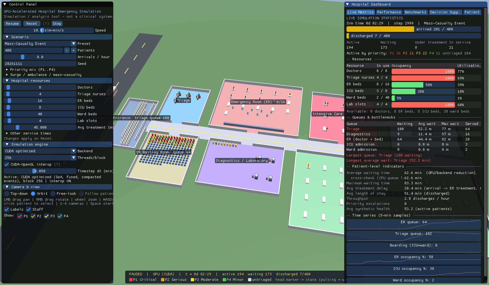
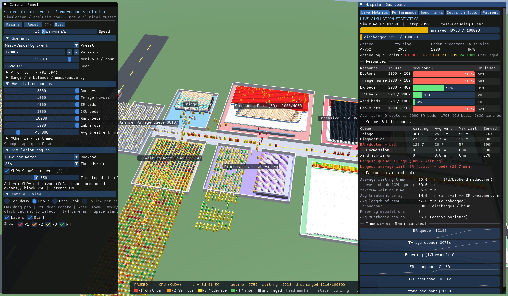
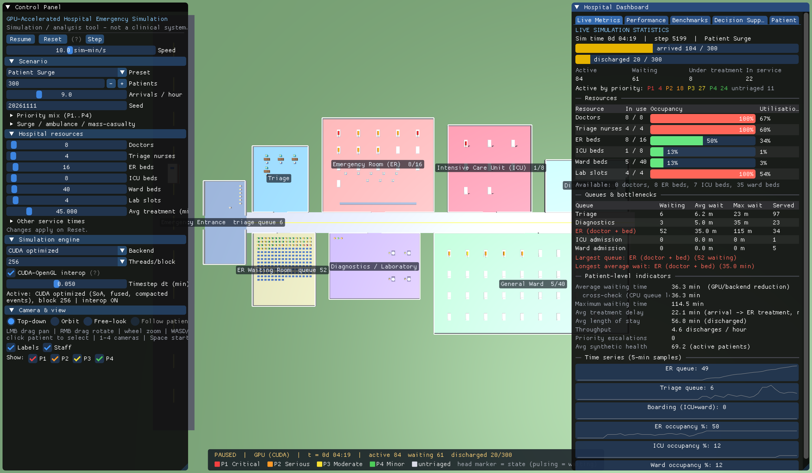
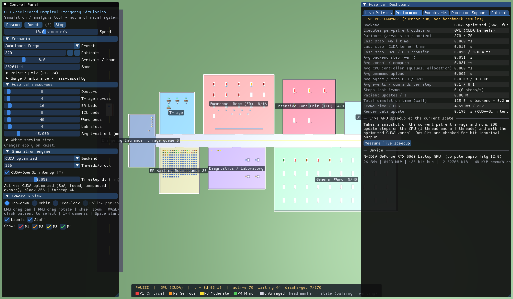

# GPU-Accelerated 3D Hospital Emergency Simulation

**Real-time patient flow and resource optimization with CUDA and OpenGL.**
Final-year project for *Parallel Architecture and GPU Programming* (PAGP) and *Computer Graphics and Virtual Reality* (CGVR).

> **Disclaimer:** this is a simulation and analysis tool. Priorities, durations and deterioration rates are synthetic
> model parameters. It is **not** a hospital management system and **not** a clinically validated triage protocol.



| 100,000 patients (CUDA + CUDA-GL interop) | Patient surge, top-down | Live performance panel |
|---|---|---|
|  |  |  |

## What it does

* Simulates an emergency department: entrance, triage, waiting room, ER, diagnostics/lab, ICU, general ward,
  discharge and corridors. Patients have P1–P4 priorities, a full state machine, queues, exclusive resources
  (doctors, nurses, ER/ICU/ward beds, lab slots), boarding, deterioration and priority escalation.
* Four scenarios: normal operation, patient surge, ambulance surge, mass-casualty event. All parameters are configurable.
* **Hybrid CPU–GPU engine.** The CUDA kernels update every patient in parallel (movement, waiting time, treatment progress,
  deterioration, event compaction, reductions, render packing). The CPU runs the dependency-heavy parts (queues,
  race-free resource allocation, state machine).
* **Verified equivalence.** The CPU baseline and all CUDA variants run the *same* `__host__ __device__` code and produce
  **bit-identical** results, which is checked in tests and in every benchmark row.
* Interactive **OpenGL 3.3** hospital: instanced patients coloured by priority with state markers, lying patients in beds,
  moving doctors, labels. Top-down, orbit, free-look and follow-patient cameras.
* **Dear ImGui dashboard:** scenario/resource controls, live metrics and bottleneck detection, live performance,
  in-app benchmarks, A/B configuration comparison, patient inspector.
* **Benchmark mode:** CPU (1 thread / OpenMP) vs CUDA naive / optimized / CUDA-Graph / event-batched. Includes AoS vs SoA,
  block sizes, ordering and active lists. Writes CSV + graphs.

## Build

Requirements (tested versions): Windows 10/11, Visual Studio 2022 Build Tools (MSVC 19.44, "Desktop development with C++"),
CUDA Toolkit 13.5, CMake ≥ 3.24 (tested 4.4), Ninja (optional), NVIDIA driver supporting your CUDA version.
GLFW 3.4, GLM 1.0.1, Dear ImGui 1.91.9 and a GLAD GL 3.3 core loader are vendored in `third_party/`.

```bat
build.bat                      :: Release build with MSVC + Ninja (+ CUDA if found)
build.bat Debug
build.bat Release "-DHS_ENABLE_CUDA=OFF"   :: CPU-only build (GPU features report "unavailable")
```

Manual: run from a *x64 Native Tools* prompt:

```bat
cmake -S . -B build -G Ninja -DCMAKE_BUILD_TYPE=Release
cmake --build build
```

Outputs are in `build/bin/`: `hospital_sim.exe` (application + CLI) and `hospital_tests.exe`.
CUDA architectures default to `native`. Override with `-DCMAKE_CUDA_ARCHITECTURES=86;89;120` for other GPUs.

## Run

```bat
build\bin\hospital_sim.exe                       :: interactive 3D application
build\bin\hospital_tests.exe                     :: 14 tests / 447 checks
build\bin\hospital_sim.exe --benchmark           :: full CPU vs GPU experiments -> benchmarks\results\*.csv
python benchmarks\plot_results.py                :: graphs -> benchmarks\results\graphs\*.png
build\bin\hospital_sim.exe --run 3 --backend gpu :: headless mass-casualty run with metrics
build\bin\hospital_sim.exe --compare 2           :: configuration A vs B (decision support)
benchmarks\profile_ncu.bat                       :: Nsight Compute kernel metrics (run as administrator)
```

See [docs/USER_GUIDE.md](docs/USER_GUIDE.md) for controls, dashboard tabs and a demonstration script.

## Results (summary)

The full tables, graphs and analysis are in [docs/BENCHMARKS.md](docs/BENCHMARKS.md). Every number comes from
`benchmarks/results/*.csv`, measured on an RTX 5060 Laptop GPU and a Core Ultra 7 255HX.

**Per-patient update, 200 steps** (kernel suite; speedup vs one CPU core; all outputs bit-identical):

| Patients | CPU 1 thread | CPU 20 threads | CUDA naive (E2E) | CUDA optimized (kernel) | CUDA optimized (E2E) | Speedup kernel / E2E |
|---:|---:|---:|---:|---:|---:|---:|
| 1,000 | 1.2 ms | 1.7 ms | 24 ms | 3.3 ms | 12.5 ms | 0.4× / 0.1× |
| 10,000 | 29 ms | 5.8 ms | 37 ms | 2.7 ms | 12.2 ms | 10.6× / 2.4× |
| 100,000 | 469 ms | 32 ms | 176 ms | 3.1 ms | 14.9 ms | 150× / 31× |
| 500,000 | 2,101 ms | 129 ms | 787 ms | 6.0 ms | 42.5 ms | 349× / 49× |
| 1,000,000 | 3,246 ms | 245 ms | 1,591 ms | 29.7 ms | 90.8 ms | 109× / 36× |

Key findings:

* The GPU pays off from about 5–10k patients. Below that, kernel launch and synchronisation latency
  (≈ 15–50 µs/step on Windows WDDM) exceeds the work.
* SoA + fusion + selective loads beats AoS fused by 1.3–3.3×. Selective loads were added after a first measurement
  showed split kernels beating the fused kernel once the data outgrew the 32 MB L2 (−39% at 1M).
* The naive version (whole array copied both ways every step) is transfer-bound and never beats 20 CPU threads.
* In the **full coupled simulation** (CPU controller every step), the GPU is latency-bound. Nsight Systems shows 2.3 µs
  kernels against ~40 µs synchronisations, so 20 CPU threads remain faster up to 100k patients (10.8× vs 6.9×).
  Event-driven batching cuts synchronisations by about 12× when events are sparse.

## Documentation

| Document | Contents |
|---|---|
| [docs/ARCHITECTURE.md](docs/ARCHITECTURE.md) | modules, data model, state machine, hybrid step, invariants, rendering |
| [docs/CUDA_IMPLEMENTATION.md](docs/CUDA_IMPLEMENTATION.md) | CPU/GPU split, grid/block/thread, kernels, memory hierarchy, synchronisation, optimizations |
| [docs/METHODOLOGY.md](docs/METHODOLOGY.md) | methodology flowchart, simulation model, experimental method, threats to validity |
| [docs/BENCHMARKS.md](docs/BENCHMARKS.md) | measured results, graphs, profiling, sanitizer, analysis |
| [docs/USER_GUIDE.md](docs/USER_GUIDE.md) | controls, dashboard, CLI, demo script |
| [docs/PRESENTATION_AND_VIVA.md](docs/PRESENTATION_AND_VIVA.md) | 5–10 min PAGP talk outline and 24 viva Q&As |

## Project layout

```
include/   headers (Patient.h + PatientUpdate.h are shared by CPU and CUDA)
src/       C++: simulation engine, CPU backend, generator, resources, benchmark, app, renderer, camera, dashboard
cuda/      CUDA: kernels, CUDA backend, memory management, kernel benchmark
shaders/   GLSL 330 shaders
tests/     unit + integration tests (CPU, GPU, CPU-GPU equivalence)
benchmarks/ plot script, results (CSV + graphs), initial-run results
docs/      documentation
third_party/ glfw, glm, imgui, glad
```
