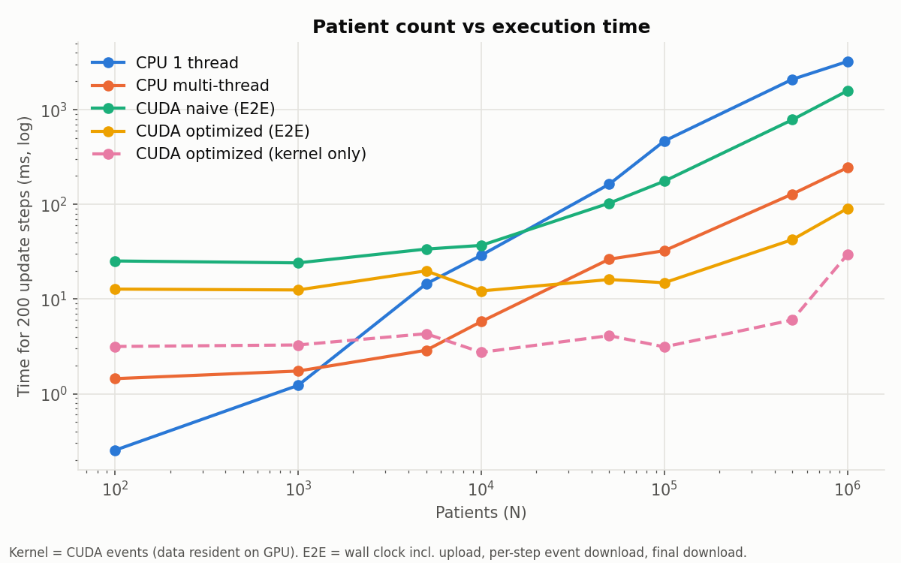
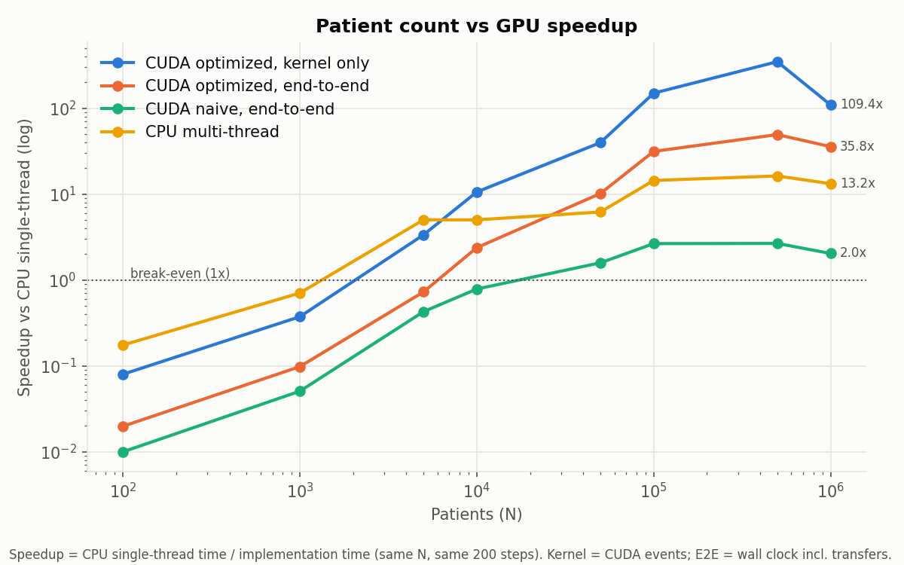
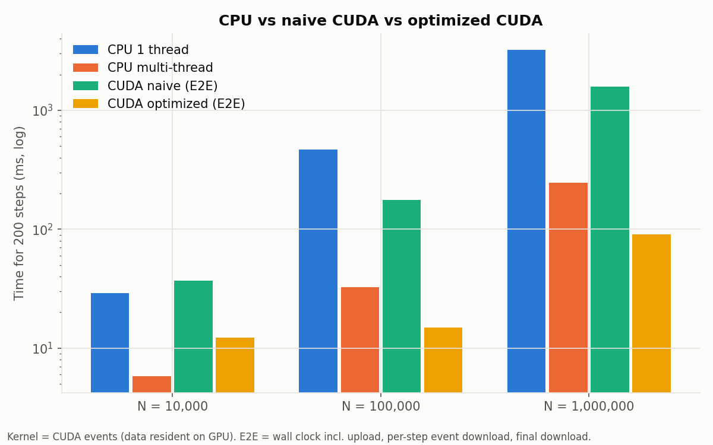
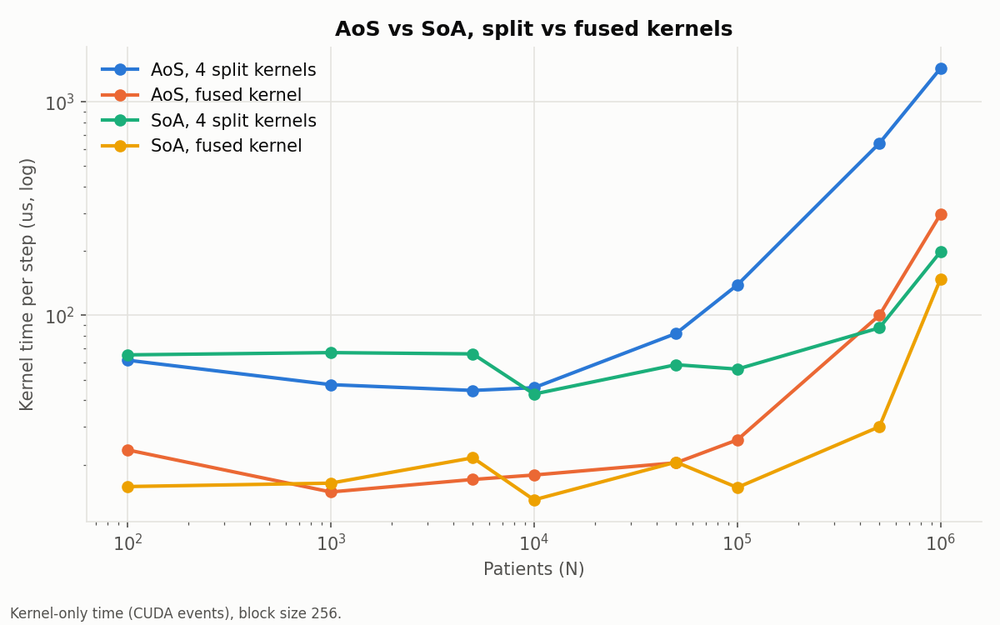
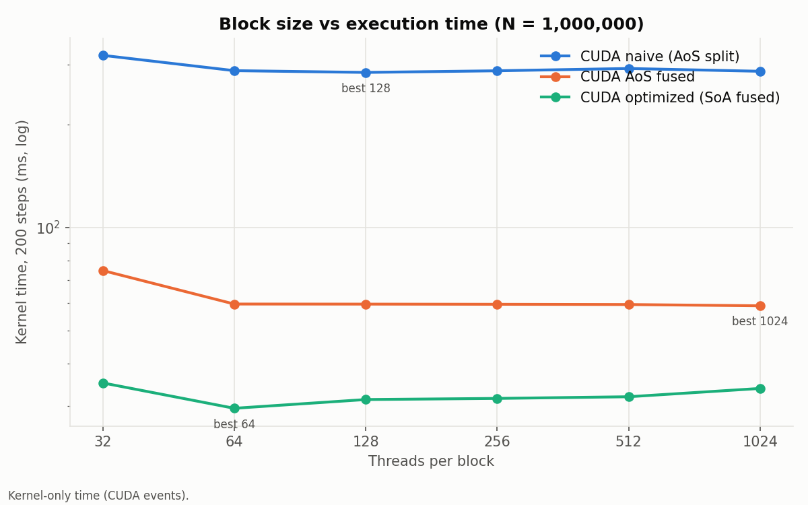
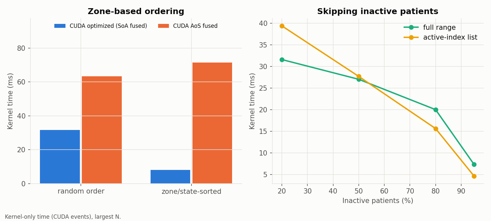
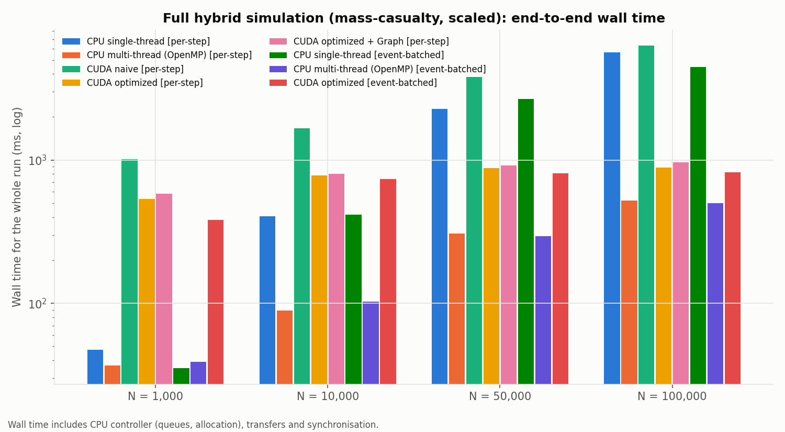

# Benchmarks and Experimental Results

All numbers below are copied from `benchmarks/results/kernel_benchmark.csv` and
`benchmarks/results/scenario_benchmark.csv`, produced by `hospital_sim --benchmark`.
The first measurement run (before two fixes described below) is kept in `benchmarks/results_initial/`.
Graphs: `benchmarks/results/graphs/*.png` (`python benchmarks/plot_results.py`).

**System:** Intel Core Ultra 7 255HX (20 cores / 20 threads), 16 GB RAM, NVIDIA GeForce RTX 5060 Laptop GPU
(sm_120, 26 SMs, 8 GB, 128-bit bus, 32 MB L2), Windows 11 (WDDM driver 621.01), CUDA 13.5, MSVC 19.44 `/O2`,
OpenMP 2.0 with 20 threads.

**Correctness of every row.** Each GPU and CPU-MT run is compared with the CPU single-thread run on the same input.
Final state: 13 fields × N patients, max |Δ| and integer mismatches. Event stream: count + hash of
`(step, id, bits, priority)`. **Every row in both CSVs is bit-identical (max |Δ| = 0, 0 mismatches, equal event
hashes); every scenario run produces identical patient outcomes.**

## Timing definitions

| Term | Definition |
|---|---|
| CPU time | `steady_clock` around the update loop (data already in memory) |
| **Kernel-only** | CUDA events around `steps` back-to-back launches (+ per-step `memset` of the event counter); data resident on the GPU; no host interaction |
| **End-to-end (E2E)** | wall clock: initial upload + every step's kernel(s) + the per-step transfer the CPU controller needs (event count + events; whole arrays for *naive*) + synchronisation + final download |
| Speedup | CPU single-thread time / implementation time, at the same N and step count |

Kernel suite workload: a synthetic, deterministic population (seed 42) with a realistic mix of states
(20% inactive, ~30% moving, queues, treatment, ICU/ward), **200 update steps**, dt = 0.02 min, median of 3 runs,
block size 256 unless stated.

---

## 1. Scaling: CPU vs naive CUDA vs optimized CUDA  (graphs 01, 02, 05)

Time for 200 steps (ms):

| N | CPU 1 thread | CPU 20 threads | CUDA naive E2E | CUDA optimized kernel | CUDA optimized E2E | Speedup kernel | Speedup E2E |
|---:|---:|---:|---:|---:|---:|---:|---:|
| 100 | 0.25 | 1.44 | 25.3 | 3.16 | 12.8 | 0.08× | 0.02× |
| 1,000 | 1.23 | 1.74 | 24.2 | 3.28 | 12.5 | 0.37× | 0.10× |
| 5,000 | 14.5 | 2.88 | 33.8 | 4.31 | 19.9 | 3.4× | 0.73× |
| 10,000 | 29.1 | 5.79 | 37.0 | 2.74 | 12.2 | 10.6× | 2.4× |
| 50,000 | 164 | 26.4 | 103 | 4.11 | 16.1 | 39.9× | 10.2× |
| 100,000 | 469 | 32.5 | 176 | 3.13 | 14.9 | **150×** | 31.5× |
| 500,000 | 2,101 | 129 | 787 | 6.02 | 42.5 | **349×** | **49.4×** |
| 1,000,000 | 3,246 | 245 | 1,591 | 29.7 | 90.8 | 109× | 35.8× |




**Analysis**

* **Crossover.** The GPU kernel beats one CPU core from about 5k patients, and end-to-end from about 10k. Against all 20 CPU
  threads, the optimized GPU is faster end-to-end from about 50k patients (16.1 vs 26.4 ms).
* **Launch-latency floor.** From N = 100 to N = 100,000 the optimized kernel time is almost constant (≈ 3 ms per
  200 steps ≈ 15 µs/step). The GPU finishes 100k patients faster than the CPU can submit the next kernel, so the
  kernel-only speedup in this range measures launch overhead, not computation.
* **L2 → DRAM transition.** Per patient-step the kernel costs 0.060 ns at 500k but 0.148 ns at 1M (2.5× more). The SoA
  arrays are 52 B × N: 26 MB fit in the 32 MB L2, 52 MB do not. Beyond that the kernel is DRAM-bandwidth bound, which
  is why the speedup peaks at 500k.
* **End-to-end vs kernel-only.** E2E includes one host synchronisation per step (event count + events). At 100k this
  makes E2E ≈ 5× the kernel time. Both figures are reported; neither is hidden.
* **Naive CUDA** copies the whole 52 B × N array to the GPU and back every step, plus 4 B/patient of event bits.
  At 1M that is 1,099 ms of the 1,591 ms (≈ 20 GB/s effective). It never beats 20 CPU threads.



## 2. AoS vs SoA, split vs fused  (graph 03)

Kernel-only time for 200 steps (ms):

| N | AoS, 4 split kernels (naive) | AoS fused | SoA, 4 split + compaction | **SoA fused (optimized)** | SoA fused vs AoS fused |
|---:|---:|---:|---:|---:|---:|
| 10,000 | 9.17 | 3.58 | 8.57 | 2.74 | 1.3× |
| 100,000 | 27.8 | 5.23 | 11.2 | 3.13 | 1.7× |
| 500,000 | 128 | 20.0 | 17.5 | 6.02 | 3.3× |
| 1,000,000 | 287 | 59.6 | 39.8 | 29.7 | 2.0× |



* **Fusion** matters most for AoS. Each split AoS kernel reloads and rewrites the 52-byte struct, which costs 4.8× at 1M.
* **SoA beats AoS** in the fused form by 1.3–3.3×. SoA gives coalesced 128-byte warp transactions per field, and with
  selective loads an inactive or idle patient costs a single 4-byte load instead of a full struct.
* **SoA did *not* always win in our first version.** In `results_initial/`, at N = 1M the fused SoA kernel took 48.5 ms
  and lost to the *split* SoA kernels (40.3 ms). Once the data exceeded the L2 cache, bytes moved became decisive.
  The first fused kernel loaded all 13 fields of every active patient, whereas the split kernels only load fields when
  the state needs them. We then made the fused kernel's loads/stores **selective** (positions only if moving, timer
  only in service states, health only when it changes, store only modified fields). Result: **48.5 → 29.7 ms (−39%)**,
  bit-identical output. The SoA layout is what makes this kind of field-level selectivity possible.

## 3. Block size  (graph 04)

N = 1,000,000, kernel-only time for 200 steps (ms):

| Threads / block | 32 | 64 | 128 | 256 | 512 | 1024 |
|---|---:|---:|---:|---:|---:|---:|
| CUDA naive (AoS split) | 319.3 | 288.0 | 284.6 | 287.7 | 292.2 | 286.8 |
| CUDA AoS fused | 74.8 | 59.7 | 59.6 | 59.6 | 59.5 | 59.0 |
| **CUDA optimized (SoA fused)** | 35.1 | **29.5** | 31.3 | 31.6 | 31.9 | 33.8 |



32 threads per block is clearly worst: one warp per block, so the per-SM block limit caps resident warps and therefore
latency hiding. From 64 to 512 the results are within 8% for every variant: the kernel is memory-bound and
occupancy is sufficient at all these sizes. 64 was marginally fastest on this GPU. We keep 256 as the default because
the difference is in the noise and 256 is robust across GPUs.

## 4. Zone-based partitioning / ordering  (graph 06, left)

N = 1,000,000, same population, random order vs **sorted by state/zone** (kernel-only, 200 steps, ms):

| | random order | zone/state-sorted | effect |
|---|---:|---:|---:|
| CUDA optimized (SoA fused) | 31.6 | **8.09** | **3.9× faster** |
| CUDA AoS fused | 63.4 | 71.5 | 13% slower |
| CPU single-thread | 3,028 | 1,499 | 2.0× faster (branch prediction) |



Sorting makes the 32 threads of a warp take the same branch (no divergence). With SoA + selective loads, whole warps
also skip the same fields, so entire 128-byte transactions disappear: for example, a warp of waiting patients never touches
positions. AoS gains nothing, because it loads the whole struct regardless of state. **Conclusion:** zone-based
ordering is worth it with SoA. In the live simulation patients change state continuously, so it would need periodic
re-sorting (a GPU radix sort by state every *k* steps). That is left as future work, because the live per-step cost is
dominated by synchronisation (§6), not by the kernel.

## 5. Active-index list vs full range  (graph 06, right)

N = 1,000,000, kernel-only, 200 steps (ms):

| inactive patients | 20% | 50% | 80% | 95% |
|---|---:|---:|---:|---:|
| full range (inactive = 1 load + exit) | **31.6** | **27.0** | 20.0 | 7.35 |
| explicit active-index list | 39.4 | 27.7 | **15.6** | **4.66** |

An index list adds an indirection (`idx[i]`), so accesses are no longer perfectly coalesced, and it needs maintenance.
It only pays off when 80% or more of patients are inactive. Because the optimized kernel already makes inactive patients
cheap (one 4-byte load), the full-range kernel is kept.

## 6. Full hybrid simulation (scenario suite)  (graph 07)

Mass-casualty preset scaled to N patients (arrivals and resources scale with N), **6 simulated hours = 7,200 steps**,
seed 42. Wall time for the whole run, including the CPU controller (queues, allocation), transfers and synchronisation.
These runs disable per-step CUDA-event instrumentation (see §7). All 32 runs produce **identical outcomes** to the CPU
single-thread run.

| Configuration | N = 1,000 | 10,000 | 50,000 | 100,000 |
|---|---:|---:|---:|---:|
| CPU 1 thread, per-step (reference) | 47 ms | 406 ms | 2,280 ms | 5,663 ms |
| CPU 20 threads, per-step | 37 | **89** | **306** | **524** |
| CUDA naive, per-step | 1,015 | 1,664 | 3,823 | 6,323 |
| CUDA optimized, per-step | 535 | 783 | 882 | 884 |
| CUDA optimized + Graph, per-step | 582 | 804 | 918 | 965 |
| CPU 1 thread, event-batched | **35** | 415 | 2,670 | 4,487 |
| CUDA optimized, event-batched | 384 | 735 | 810 | 824 |
| *Speedup CUDA optimized (best) vs CPU 1T* | 0.12× | 0.55× | 2.8× | **6.9×** |
| *Speedup CPU 20 threads vs CPU 1T* | 1.3× | 4.6× | 7.5× | **10.8×** |



**This is the most important systems result, and it is not the "GPU wins everything" story:**

* The CUDA time is almost **flat in N** (535 → 884 ms from 1k to 100k patients). The GPU's actual work is tiny. Nsight
  Systems on the 100k run (`benchmarks/profiling/`) shows an average `k_fused_soa` execution time of **2.3 µs**, while
  the host spends 41 µs per `cudaStreamSynchronize`, 10.8 µs per `cudaMemcpyAsync` call and 9.3 µs per
  `cudaLaunchKernel` call (Windows WDDM submission overhead).
* So the coupled CPU↔GPU loop is **latency-bound**. Each simulated step needs the GPU's events before the CPU can
  allocate resources, and the next step needs the CPU's decisions. In this regime, 20 CPU threads with shared memory
  and no transfers beat the GPU up to at least 100k patients.
* **CUDA Graphs** (one launch instead of memset + kernel + 2 copies) gave 15–21% in the initial run, where per-step event
  timing added extra API calls, but are 3–9% *slower* in the final, uninstrumented runs. The remaining cost is
  synchronisation latency, not submission count.
* **Event-driven batching** (K kernels per synchronisation with on-device early exit) cuts synchronisations by about 12×
  in sparse-event scenarios: 42,196 steps need only 3,485 synchronisations in the Normal preset, and the GPU time drops
  from 3.5 s to 0.9 s (measured during development, `event_batching_identical` test). In the scaled mass-casualty runs,
  arrivals occur almost every step, which forces a CPU cycle each step, so the gain there is only 6–28%.
* The GPU becomes clearly worthwhile where per-step work exceeds the latency floor: the kernel suite's 10⁵–10⁶ patients
  (§1), or workloads that run many steps without CPU interaction.

Development history (`results_initial/` vs `results/`): with per-step CUDA-event timing *on*, the optimized per-step run
at 100k took 1,067 ms. Without instrumentation and with selective loads it takes 884 ms.

## 7. Instrumentation and latency measurements

| Measurement (Normal preset, 220 patients, 42,196 steps, CUDA optimized) | Wall time |
|---|---:|
| two synchronisations per step, CUDA-event timing on | 3,418–3,535 ms |
| one synchronisation per step (speculative prefix copy), timing on | 3,525 ms |
| one synchronisation per step, timing **off** (`--no-event-timing`) | 1,961–2,284 ms |
| CUDA Graph, timing off | 2,118 ms |
| event-driven batching, timing on | 896 ms |
| CPU single-thread | 78–90 ms |

Per-step CUDA event recording costs about 30–35 µs on WDDM (≈ 40% of a step). It is therefore disabled for wall-clock
comparisons and kept for the kernel breakdown and the live dashboard.

## 8. Profiling

### Nsight Systems (timeline, `benchmarks/profiling/scenario_100k*`)

Command:

```
nsys profile --trace=cuda -o benchmarks/profiling/scenario_100k ^
     build/bin/hospital_sim.exe --run 3 --patients 100000 --backend gpu --no-event-timing
nsys stats --report cuda_gpu_kern_sum --report cuda_api_sum --report cuda_gpu_mem_time_sum ...
```

| GPU activity | Instances | Avg | Total |
|---|---:|---:|---:|
| `k_fused_soa` | 145,970 | 2.27 µs | 332 ms |
| `k_apply_cmds_soa` (scatter of CPU decisions) | 71,554 | 0.72 µs | 51 ms |
| D2H copies (event count + events) | 148,665 | 2.29 µs | 341 ms |
| H2D copies (commands) | 71,569 | 1.12 µs | 80 ms |
| memsets (event counter) | 121,322 | 0.65 µs | 79 ms |

| Host CUDA API | Calls | Avg | Total |
|---|---:|---:|---:|
| `cudaStreamSynchronize` | 74,334 | 40.7 µs | 3.02 s |
| `cudaMemcpyAsync` | 220,232 | 10.8 µs | 2.39 s |
| `cudaLaunchKernel` | 217,525 | 9.3 µs | 2.03 s |
| `cudaMemsetAsync` | 121,322 | 5.0 µs | 0.60 s |

GPU busy time is ≈ 0.88 s, against ≈ 8 s of host API time. **The full simulation is bound by host-side API and
synchronisation latency, not by GPU computation or bandwidth.** This motivated the batching optimisation, and it shows
where further work would go (a persistent kernel or moving the controller to the GPU; see the viva notes Q22).

### Nsight Compute (kernel metrics)

GPU performance counters require administrator rights on Windows by default (`ERR_NVGPUCTRPERM`).
`benchmarks/profile_ncu.bat` (run as administrator) profiles each kernel in its own pass (`--set full`, one launch
after one warm-up launch). The workload is `hospital_sim --profile 1000000`: 1M patients in random order, 20% inactive,
256 threads/block, 3,907 blocks. Reports: `benchmarks/profiling/ncu_<kernel>.ncu-repz`; exported sections:
`benchmarks/profiling/kernels_1M_details.csv`; log: `ncu_log.txt`.

Nsight Compute locks the GPU clocks to base frequency and replays each kernel about 40 times, so the durations below are
longer than the benchmark timings in §2. Use them to compare kernels with each other, not as absolute times.

| Kernel | Duration | DRAM throughput (% peak) | DRAM GB/s | SM throughput | L2 hit | Achieved occupancy | Regs/thread | Active threads/warp | Warp cycles/issue |
|---|---:|---:|---:|---:|---:|---:|---:|---:|---:|
| `k_move_aos` (naive split, 1 of 4) | 551 µs | 51% | 194 | 9% | 88% | 91% | 40 | 20.5 | 366 |
| `k_fused_aos` | 290 µs | 83% | 316 | 21% | 68% | 80% | 40 | 16.8 | 89 |
| `k_move_soa` (split, 1 of 4) | 126 µs | 90% | 313 | 48% | 31% | 89% | 38 | 14.9 | 59 |
| `k_compact_soa` | 33 µs | 48% | 166 | 22% | 14% | 65% | 20 | 22.3 | 35 |
| `k_fused_soa` (optimized) | 197 µs | 89% | 338 | 40% | 32% | 92% | 40 | 14.7 | 44 |
| `k_fused_soa_active` | 267 µs | 80% | 277 | 27% | 33% | 86% | 40 | 17.4 | 73 |

Theoretical occupancy is 100% for every kernel: 40 registers × 256 threads does not limit residency on sm_120.

What the counters show:

* **The kernels are memory-bound.** The optimized `k_fused_soa` runs at 89% of peak DRAM throughput but only 40% of SM
  throughput, and it streams the most bytes per second of all the variants. The SoA kernels run 1.5× faster than
  `k_fused_aos` because they read less data, not because they compute faster. Roofline-wise they sit on the bandwidth
  slope.
* **The AoS movement kernel is latency-bound, not bandwidth-bound.** `k_move_aos` reaches only 51% of DRAM peak,
  despite an 88% L2 hit rate, and waits 366 cycles per issued instruction. A strided 52-byte AoS record per thread
  touches several cache sectors per warp access, so warps stall on many partially used transactions. That is the
  uncoalesced-access cost that SoA removes: the SoA kernel waits 59 cycles per instruction instead of 366.
* **Occupancy is not the limit.** Achieved occupancy is 80–92% everywhere except the short compaction kernel, which
  explains why block size had less than 8% effect (§3).
* **Branch divergence is real.** In random order only 14.7–17.4 of 32 threads per warp are active in the fused
  kernels. This is the counter-level cause of the 3.9× gain from sorting patients by zone/state (§4).
* **The active-index list adds an indirection.** `k_fused_soa_active` raises the active-thread count slightly (17.4)
  but loses coalescing through the gather, so DRAM efficiency drops to 80%. This matches §5, where the list only pays
  off when at least 80% of patients are inactive.

### compute-sanitizer

memcheck, racecheck, synccheck and initcheck report **0 errors / 0 hazards** for all kernel variants (N = 4097, not a
multiple of the block size), N = 0, out-of-range command ids and a full GPU scenario. See
`benchmarks/profiling/sanitizer_results.txt`. initcheck initially flagged the speculative event-prefix copy reading
never-written slots; the event buffers are now zero-initialised.

## 9. Summary of what helped and what did not

| Optimization | Measured effect | Kept |
|---|---|---|
| Keep data resident on GPU (vs naive full copies) | E2E 1,591 → 91 ms at 1M (17.5×) | ✔ |
| Kernel fusion (AoS) | 287 → 59.6 ms at 1M (4.8×) | ✔ |
| SoA layout (fused) | 1.3–3.3× vs AoS fused | ✔ |
| Selective field loads in fused SoA kernel | 48.5 → 29.7 ms at 1M (−39%) | ✔ |
| GPU event compaction (warp-aggregated) | transfers `count + events` instead of N flags + whole array | ✔ |
| Single sync per step (speculative prefix) | no measurable change on its own | ✔ (simpler) |
| Event-driven multi-step batching | 12× fewer syncs, 3.5 s → 0.9 s (Normal); 6–28% (MCI) | ✔ |
| CUDA Graph per step | up to −21% with instrumentation on; +3…9% without | optional variant |
| Block size 64–512 | within 8%; 32 is worst | 256 |
| Zone/state sorting | 3.9× (SoA kernel), needs re-sorting in the live sim | experiment |
| Active-index list | only helps at ≥ 80% inactive | experiment |
| CUDA-OpenGL interop | removes the device→host→device copy of render data (≈ 1.2 MB/frame at 100k) | optional |
